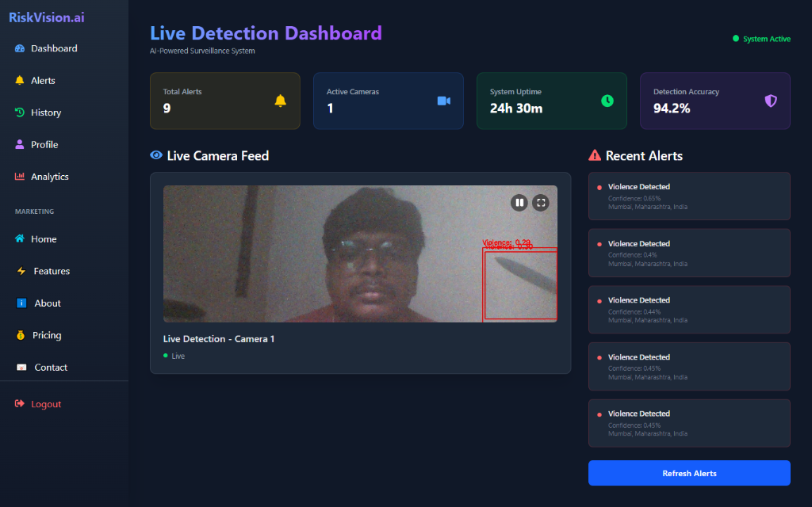

# RiskVision.ai — Real-Time AI Surveillance & Threat Detection

[](LICENSE)
[](https://www.python.org/)
[](https://flask.palletsprojects.com/)
[](https://react.dev/)
[](https://vitejs.dev/)
[](https://github.com/ultralytics/ultralytics)
[](https://tailwindcss.com/)

An AI-powered computer vision surveillance platform designed for real-time violence detection, automated incident recording, and multi-channel security alerting. Built with a fine-tuned YOLO model, a Flask REST API backend, and a high-performance React/Vite operator dashboard.

[Dashboard Preview](#dashboard-preview) • [About](#about-the-project) • [Features](#features) • [Architecture](#architecture) • [Tech Stack](#technology-stack) • [Installation](#installation-and-local-development) • [API Overview](#api-overview) • [Security & Limitations](#configuration-and-security) • [Troubleshooting](#troubleshooting) • [Contributing](#contributing-license-and-disclaimer)

---

## Dashboard Preview



*Figure: RiskVision.ai Live Detection Dashboard demonstrating real-time camera inference with bounding-box violence classification, active metrics summary, and an incoming event alert queue.*

> **Note**: Displayed dashboard metrics (such as uptime, detection accuracy, and camera counts) represent operator UI widgets and live session counters; they are not certified laboratory benchmarks.

---

## About the Project

Physical security systems and CCTV networks often produce hundreds of continuous video streams that exceed the capacity of human operators to monitor reliably. Fatigue, delayed response times, and difficult manual video retrieval can compromise security responses during critical incidents.

**RiskVision.ai** addresses this challenge through automated visual threat monitoring:

1. **Continuous Visual Processing**: Evaluates live video feeds frame-by-frame using a fine-tuned YOLO object detection network.
2. **Instant Threat Identification**: Flags violent physical interactions with localized spatial bounding boxes and confidence scoring.
3. **Automated Evidence Capture**: Maintains a rolling frame buffer to automatically encode and store a 10-second video clip and thumbnail whenever a threshold alert is triggered.
4. **Synchronized Alerting**: Logs incident records locally, synchronizes events with Firebase Realtime Database, and optionally issues SMS notifications via Twilio.
5. **Unified Operator Interface**: Provides security operators with an intuitive dark-themed web dashboard for real-time video monitoring, user account control, activity analytics, and historical incident playback.

---

## Features

### Implemented Functionality

- **Live Video Inference**: Captures video from local webcams (`VIDEO_SOURCE=0`), RTSP IP camera streams, or video files, streaming live annotated video over MJPEG (`/video_feed`).
- **YOLO Violence Classification**: Identifies physical confrontations with real-time confidence scores (trigger threshold: > 0.40 confidence) and an automated 10-second alert cooldown period.
- **Incident Clip Recording & Thumbnails**: Buffers incoming video frames via an in-memory queue (`deque`). On detection, spawns an asynchronous worker thread utilizing FFmpeg to encode an H.264 MP4 clip and generate a JPEG thumbnail.
- **Alert History & Local Logging**: Appends timestamped incident records (timestamp, location via IP geolocation, confidence, and video link) to an internal alert log and provides historical review via `/alerts`.
- **Firebase Realtime Database Synchronization**: Pushes incident detections to `violence_detections` and recorded clip metadata to `history_clips` when Firebase credentials are configured.
- **JWT-Protected User Authentication**: User registration and login with secure token generation (`flask-jwt-extended`), configurable token expiration, and profile management (`/auth/profile`).
- **Cryptographic Password Migration**: Modern password storage via Werkzeug (`generate_password_hash` / `check_password_hash`). Automatically upgrades legacy raw SHA-256 password records to salted Werkzeug hashes upon successful login.
- **Operator Analytics**: User-specific and global login trends, active user counts, and session monitoring via `/auth/analytics` and interactive Chart.js visualizations.
- **Responsive Dark-Mode Interface**: Built with React 19, Tailwind CSS 4, React Router 7, and Lucide/React Icons.

### Planned Features (Roadmap)

- Multi-camera grid monitoring and RTSP stream switcher.
- PostgreSQL / Supabase storage replacing local JSON user files.
- Cloud object storage integration (AWS S3 / Cloudflare R2) for persistent video clips.
- Role-based access control (Administrator vs. Security Monitor).

---

## Architecture

### 1. System Overview

RiskVision.ai is architected as an edge-ready computer vision monitoring platform combining a monolithic Python/Flask API backend with a high-performance React 19 / Vite operator interface. The architecture separates live visual inference from request-response web servicing while maintaining synchronized event reporting across local storage, cloud synchronization, and real-time client visualizations.

The core design centers on three concurrent runtime concerns:
1. **Continuous Video Ingestion & Frame Streaming**: OpenCV captures raw video input, stores incoming frames in a thread-safe rolling queue, and yields multipart MJPEG frames over HTTP to the browser.
2. **Real-Time Threat Inference & Alert Dispatch**: An integrated YOLOv11 neural network evaluates resized frames in-line, detects violent interactions against a calibrated confidence threshold, enforces cooldown suppression, and offloads video clip encoding to asynchronous background worker threads.
3. **Operator Management & Telemetry API**: Flask REST endpoints handle JWT-authenticated session lifecycle, user profile operations, historical alert queries, login trends, and on-demand MP4 media streaming.

---

### 2. Complete Layered Architecture Diagram

The following diagram illustrates the verified system architecture, component boundaries, and directional data flows across all application layers:

```mermaid
flowchart TD
    subgraph Layer1["Layer 1: Client & Presentation (React 19 + Vite)"]
        DashboardUI["Operator Dashboard & Live Video Player"]
        AlertsView["Alert Queue & Historical Playback"]
        AnalyticsView["Telemetry & Trends (Chart.js)"]
        ProfileView["User Account & Profile Management"]
        AuthContext["Auth Context & Token Store (localStorage)"]
    end

    subgraph Layer2["Layer 2: API & Communication (Flask Application)"]
        CORSFilter["Flask-CORS Origin Whitelist Filter"]
        APIRouter["Flask HTTP Request Router"]
        VideoStreamRoute["GET /video_feed (MJPEG Multipart Stream)"]
        AuthRoutes["POST /auth/register, POST /auth/login, /auth/profile"]
        AnalyticsRoute["GET /auth/analytics (JWT Required)"]
        AlertRoutes["GET /alerts, GET /history_clips, GET /thumbnails"]
    end

    subgraph Layer3["Layer 3: Authentication & Application Services"]
        JWTManager["Flask-JWT-Extended (Token Generation & Expiry)"]
        PasswordHash["Werkzeug Security (Salted Hashing & SHA-256 Migration)"]
        UserMgmt["User Profile & Session Analytics Service"]
        AlertService["Alert Log Reader & Formatter"]
    end

    subgraph Layer4["Layer 4: Computer Vision & Inference Pipeline"]
        VideoInput["Video Source (Local Webcam 0 / RTSP / Video File)"]
        OpenCVEngine["OpenCV VideoCapture (1280x720 at 30 FPS)"]
        FrameQueue["Thread-Safe Rolling Frame Buffer (deque maxlen=300)"]
        FrameResize["Preprocessing & Frame Resizing (640x640)"]
        YOLOEngine["YOLOv11n Detection Model (best.pt)"]
        Classifier["Class Filtering & Confidence Threshold (Conf >= 0.40)"]
        MJPEGStreamer["MJPEG Stream Generator (Annotated Frames)"]
    end

    subgraph Layer5["Layer 5: Alert Coordination & Media Processing"]
        CooldownGate["Alert Cooldown Controller (10s Suppression)"]
        GeoLocator["IP Geolocation Resolver (ip-api.com)"]
        AsyncDispatcher["Thread Dispatcher (Background Worker)"]
        FFmpegWorker["FFmpeg CLI (libx264 H.264 MP4 Encoding)"]
        ThumbExtractor["FFmpeg CLI (JPEG Thumbnail Extraction)"]
    end

    subgraph Layer6["Layer 6: Persistence & External Integrations"]
        UserJSON["Local User Storage (users.json)"]
        AlertLogJSON["Local Incident Log (alert_log.json)"]
        MediaFiles["Local Filesystem Storage (static/history_clips/)"]
        FirebaseRTDB["Firebase Realtime Database (Cloud - Optional)"]
        TwilioAPI["Twilio REST SMS Service (Cloud - Optional)"]
    end

    DashboardUI -->|HTTP GET Request| AlertRoutes
    DashboardUI -->|Continuous MJPEG Stream| VideoStreamRoute
    AlertsView -->|HTTP GET & Media Playback| AlertRoutes
    AnalyticsView -->|HTTP GET with Bearer Token| AnalyticsRoute
    ProfileView -->|HTTP GET and PUT with Bearer Token| AuthRoutes
    AuthContext -->|Session Tokens| DashboardUI
    AuthContext -->|Authentication Requests| AuthRoutes

    CORSFilter --> APIRouter
    APIRouter --> AuthRoutes
    APIRouter --> AnalyticsRoute
    APIRouter --> AlertRoutes
    APIRouter --> VideoStreamRoute

    AuthRoutes --> JWTManager
    AuthRoutes --> PasswordHash
    AuthRoutes --> UserMgmt
    AnalyticsRoute --> JWTManager
    AnalyticsRoute --> UserMgmt
    AlertRoutes --> AlertService

    UserMgmt -->|Read & Write Records| UserJSON
    AlertService -->|Read Chronological Alerts| AlertLogJSON
    AlertRoutes -->|Serve MP4 Clips & Thumbnails| MediaFiles

    VideoInput -->|Raw Video Frames| OpenCVEngine
    OpenCVEngine -->|Push Raw Frame Copy| FrameQueue
    FrameQueue --> FrameResize
    FrameResize --> YOLOEngine
    YOLOEngine -->|Annotated Bounding Boxes| MJPEGStreamer
    MJPEGStreamer -->|Yield Chunked Frame Bytes| VideoStreamRoute
    YOLOEngine -->|Detections & Confidence Scores| Classifier

    Classifier -->|Violence Class Conf at or above 0.40| CooldownGate
    CooldownGate -->|Resolve Coordinates| GeoLocator
    CooldownGate -->|Append Incident Record| AlertLogJSON
    CooldownGate -.->|Push Event to violence_detections| FirebaseRTDB
    CooldownGate -.->|Send SMS Alert to Administrator| TwilioAPI
    CooldownGate -->|Copy Buffer Snapshot & Spawn Thread| AsyncDispatcher

    AsyncDispatcher -->|Execute Background Subprocess| FFmpegWorker
    FFmpegWorker -->|Write H.264 MP4 Video File| MediaFiles
    AsyncDispatcher -->|Execute Background Subprocess| ThumbExtractor
    ThumbExtractor -->|Write 0.1s JPEG Thumbnail| MediaFiles
    AsyncDispatcher -.->|Push Clip Metadata to history_clips| FirebaseRTDB
```



---

### 3. Component Responsibility Matrix

| Component | Responsibility | Inputs | Outputs | Dependencies |
| :--- | :--- | :--- | :--- | :--- |
| **Operator UI (`RiskVision-frontend`)** | Renders live camera feed, active alerts queue, interactive analytics charts, and video history clips playback. | User clicks, API responses, MJPEG video bytes. | Rendered DOM, HTTP requests with JWT Bearer tokens. | React 19, Tailwind CSS 4, Chart.js, Axios, React Router. |
| **Auth Context (`AuthContext.jsx`)** | Manages client-side authentication state, persists JWT in browser storage, validates tokens on startup. | Login credentials, stored tokens. | User session state, `Authorization` request headers. | Axios, `localStorage`, `src/config/api.js`. |
| **API Router (`riskvision.py`)** | Exposes HTTP routes, enforces CORS whitelists, routes payloads to application services, handles errors. | Client HTTP requests (JSON / Multipart). | HTTP JSON responses, file streams, MJPEG stream. | Flask 3.1, Flask-CORS, Werkzeug. |
| **JWT Service (`flask-jwt-extended`)** | Signs cryptographically secure access tokens, validates signatures, enforces expiration intervals. | User email identity, secret key. | Base64url JWT access tokens, authenticated identity. | PyJWT, `JWT_SECRET_KEY` environment variable. |
| **Password Security Module** | Hashes passwords with pbkdf2/sha256; seamlessly verifies and upgrades legacy 64-char SHA-256 hashes. | Plaintext password, stored hash. | Salted password hash, verification boolean. | Werkzeug Security, Python `hashlib`. |
| **Video Engine (`OpenCV`)** | Connects to camera source, captures raw frames, manages frame-lock, streams MJPEG multipart chunks. | Device index (`VIDEO_SOURCE`), stream URL. | Raw BGR image arrays, JPEG encoded frame bytes. | `cv2.VideoCapture`, `cv2.imencode`. |
| **Rolling Frame Buffer** | Stores a thread-safe circular window of raw video frames (~10 seconds) for retroactive incident clipping. | Raw captured video frames. | Snapshot list of consecutive frames for encoding. | Python `collections.deque`, `threading.Lock`. |
| **YOLO Threat Detector** | Executes object detection inference, locates entities, outputs classification labels and confidence scores. | Resized 640x640 image frames. | Bounding box coordinates, class IDs, confidences. | Ultralytics YOLOv11, PyTorch (`best.pt`). |
| **Alert Coordinator** | Filters violence detections, enforces a 10s cooldown, gathers geolocation, logs alerts, triggers dispatchers. | Detection confidence, timestamp. | Formatted alert payload, background encoding jobs. | Python `threading.Thread`, `requests` (`ip-api.com`). |
| **Async FFmpeg Encoder** | Asynchronously encodes buffered frames into an H.264 MP4 file and extracts a JPEG thumbnail at 0.1s. | Array of frame images, target filename. | Compressed MP4 video clip, JPEG thumbnail file. | System `ffmpeg` binary, Python `subprocess`. |
| **Local Storage Service** | Manages local filesystem persistence for user profiles, incident logs, and encoded media files. | User records, alert entries, binary video files. | Parsed JSON objects, static media file streams. | Python `os`, `json`, local filesystem. |
| **Firebase Cloud Sync** | Synchronizes real-time detections and video history metadata to cloud Realtime Database nodes. | Alert dictionaries, clip metadata objects. | Cloud database entries under RTDB root references. | `firebase_admin` (`credentials`, `db`). |
| **Twilio SMS Gateway** | Transmits SMS alerts containing timestamps, confidence scores, and geolocations to administrators. | Formatted emergency SMS string. | Outbound cellular network SMS transmission. | `twilio.rest.Client`, Twilio API keys. |

---

### 4. End-to-End Data Flows

#### A. Live Detection & Video Inference Flow
1. **Frame Capture**: OpenCV captures raw video frames from the configured input source (`VIDEO_SOURCE`, default device `0`) at 1280x720 resolution and ~30 FPS.
2. **Buffer Ingestion**: Each acquired frame is pushed to an in-memory thread-safe circular buffer (`frame_buffer = deque(maxlen=300)`), maintaining the most recent 10 seconds of video.
3. **Preprocessing**: The frame is resized to 640x640 pixels to match the input tensor geometry expected by the YOLO network.
4. **Model Inference**: The fine-tuned YOLOv11 nano model (`best.pt`) evaluates the image frame.
5. **Post-Processing & Labeling**: The detection engine parses bounding box coordinates, applies scaling ratios, and assigns visual indicators (Red bounding box for "Violence", Green for "Non-violence").
6. **Threshold Evaluation**: If class ID `1` ("Violence") is detected with confidence exceeding `0.40`, the system hands execution to the alert coordination pipeline.
7. **MJPEG Streaming**: Annotated frames are JPEG-encoded in memory (`quality=90`) and continuously yielded to the client through the `/video_feed` HTTP multipart connection (`multipart/x-mixed-replace; boundary=frame`).
8. **Dashboard Presentation**: The operator's browser displays the live stream directly within an HTML5 `` element without requiring WebRTC or third-party plugins.

#### B. User Authentication & Profile Flow
1. **User Registration**: The client issues `POST /auth/register` with name, email, and password. The backend checks for duplicate emails, salts and hashes the password using Werkzeug, generates a UUID identifier, initializes empty analytics counters, and appends the user object to `Backend/users.json`.
2. **User Login**: The client issues `POST /auth/login`. The backend looks up the email record and evaluates the password hash:
   - If the stored hash is a legacy raw 64-character SHA-256 string, it verifies the SHA-256 sum and automatically upgrades the stored record to a salted Werkzeug hash in `users.json`.
   - If modern Werkzeug format, it validates via `check_password_hash()`.
3. **JWT Issuance**: Upon verification, `create_access_token()` generates a signed JWT token containing the user's email as identity, valid for `JWT_ACCESS_TOKEN_EXPIRES_HOURS` (default: 24h).
4. **Client Token Persistence**: The React client stores the access token in browser `localStorage` and initializes the user session in `AuthContext`.
5. **Protected API Access**: For protected operations (`GET /auth/profile`, `PUT /auth/profile`, `GET /auth/analytics`), Axios attaches the token as an HTTP header: `Authorization: Bearer <token>`.
6. **Token Validation**: `@jwt_required()` verifies the token signature against `JWT_SECRET_KEY` and confirms expiration before invoking route logic.

#### C. Incident Clip Encoding & History Playback Flow
1. **Detection Trigger**: When `send_alert()` triggers, a snapshot of all buffered frames currently residing in the 10-second `frame_buffer` is extracted under `frame_lock`.
2. **Thread Offloading**: A background daemon thread (`Thread(target=save_clip, ...).start()`) is spawned, preventing the live video stream or API responses from blocking during video compression.
3. **Temporary Staging**: The background worker writes individual frames to a temporary staging folder (`temp_frames_<clip_id>/frame_%04d.png`).
4. **Video Encoding**: A subprocess invokes FFmpeg to compile the PNG sequences into an H.264/MP4 file (`-c:v libx264 -pix_fmt yuv420p -framerate 30`) stored in `Backend/static/history_clips/<clip_id>.mp4`.
5. **Thumbnail Generation**: A second FFmpeg subprocess extracts an intra-frame at timestamp 0.1s (`-ss 00:00:00.100 -vframes 1`) to generate `Backend/static/history_clips/<clip_id>_thumb.jpg`.
6. **Temporary Cleanup**: The worker deletes the individual PNG frame files and removes the temporary staging directory.
7. **Cloud Metadata Synchronization**: If Firebase is initialized, the worker pushes the clip's filename, timestamp, and relative URL (`/history_clips/<filename>`) to the `history_clips` Realtime Database reference.
8. **Client Playback**: The frontend fetches the clips list from `GET /history_clips`, resolves relative URLs through `API_ENDPOINTS.resolveMediaUrl()`, and streams MP4 playback through `GET /history_clips/<filename>` supporting HTTP 206 byte-range seeking.

#### D. Multi-Channel Alert & Notification Flow
1. **Cooldown Suppression**: `send_alert()` checks `current_time - last_alert_time < ALERT_COOLDOWN` (10 seconds). Consecutive frames containing violent actions within this window are discarded to prevent alert storms.
2. **Geolocation Resolution**: The backend issues an outbound HTTP request to `http://ip-api.com/json/` (5s timeout) to resolve the public IP into a geographic location (`City, Region, Country`). If offline, it defaults gracefully to `"Unknown Location"`.
3. **Local Audit Logging**: The alert payload (timestamp, confidence score, location, and relative video link) is appended as a JSON line to `Backend/alert_log.json`.
4. **Firebase Cloud Broadcast**: If `FIREBASE_DATABASE_URL` and credentials are configured, the alert dictionary is pushed to the `violence_detections` Realtime Database reference for remote subscribers.
5. **Twilio SMS Notification**: If `TWILIO_ACCOUNT_SID` and `TWILIO_AUTH_TOKEN` are populated, the Twilio REST client dispatches an emergency SMS alert to `ADMIN_PHONE_NUMBER`.
6. **Frontend Polling & Alert Badge**: The React dashboard and alerts page periodically query `GET /alerts` (every 5 seconds), updating the incoming incident feed and displaying alert badges in the UI.

---

### 5. API & Communication Boundaries

```text
[ Browser / React Client ]
       │
       │  HTTP REST (JSON Payloads / JWT Bearer Tokens)
       ▼
[ CORS Filter: Whitelisted Origins (http://localhost:5173, production domain) ]
       │
       ├──► /auth/register  ──────► Creates user record in users.json
       ├──► /auth/login     ──────► Verifies password, returns JWT token
       ├──► /auth/profile   ──────► (JWT) Reads / updates user profile
       ├──► /auth/analytics ──────► (JWT) Aggregates login history statistics
       ├──► /alerts         ──────► Reads alert_log.json chronological entries
       ├──► /history_clips  ──────► Lists static/history_clips directory contents
       ├──► /history_clips/*──────► Streams H.264 MP4 with byte-range support
       └──► /video_feed     ──────► Long-lived HTTP multipart/x-mixed-replace MJPEG stream
```

- **Stateless REST**: All application endpoints (authentication, profiles, analytics, alerts) follow standard stateless REST semantics over HTTP.
- **Bearer Authentication**: Authentication tokens are passed via the standard HTTP header: `Authorization: Bearer <token>`.
- **Persistent MJPEG Channel**: Unlike polling endpoints, `/video_feed` opens a continuous HTTP connection that continuously streams JPEG image boundaries (`--frame\r\nContent-Type: image/jpeg\r\n\r\n<bytes>\r\n`) until the client disconnects.
- **CORS Governance**: Cross-Origin Resource Sharing is controlled by `CORS_ORIGINS`. Local development allows `http://localhost:5173` and `http://localhost:3000`; production environments configure explicit domain whitelists.

---

### 6. Data Persistence & External Integrations

RiskVision.ai utilizes a hybrid storage architecture balancing local execution autonomy with optional cloud synchronization:

| Storage Domain | Storage Target | Mechanism | Local Dev Behavior | Cloud / Production Behavior |
| :--- | :--- | :--- | :--- | :--- |
| **User Accounts & Profiles** | Local JSON File | `Backend/users.json` | Active, reads/writes directly to local disk. | Ephemeral container filesystems reset on deploy. (Requires PostgreSQL / Supabase migration for multi-instance scaling). |
| **Alert Incident History** | Local JSON Lines | `Backend/alert_log.json` | Appended synchronously on detection events. | Local to container instance. |
| **Incident Video Clips** | Local Filesystem | `Backend/static/history_clips/*.mp4` | Encoded via FFmpeg, stored on disk. | Ephemeral on cloud containers. (Requires S3 / R2 object storage migration for production persistence). |
| **Clip Thumbnails** | Local Filesystem | `Backend/static/history_clips/*_thumb.jpg` | Extracted via FFmpeg, served by Flask. | Ephemeral on cloud containers. |
| **Cloud Event Synchronization** | Firebase Realtime DB | `violence_detections`, `history_clips` | Optional; disabled if credentials omitted. | Active via `FIREBASE_SERVICE_ACCOUNT_JSON` environment variable. |
| **Emergency Notifications** | Twilio REST API | Programmable SMS Gateway | Optional; skipped if credentials omitted. | Active when SID, Token, and Phone Numbers configured. |
| **IP Geolocation** | `ip-api.com` HTTP API | External REST lookup (5s timeout) | Queries host's public IP location. | Queries cloud container egress IP location. |

---

### 7. Runtime & Deployment Boundaries

```text
┌────────────────────────────────────────────────────────────────────────┐
│                        CLIENT BROWSER RUNTIME                          │
│  React 19 SPA • React Router 7 • Chart.js • HTML5 Video • localStorage │
└───────────────────────────────────┬────────────────────────────────────┘
                                    │ Network (HTTP / CORS)
┌───────────────────────────────────▼────────────────────────────────────┐
│                        HOST / CONTAINER RUNTIME                        │
│                                                                        │
│  ┌─────────────────────────┐         ┌──────────────────────────────┐  │
│  │   Flask Process (WSGI)  │         │     AI Inference Engine      │  │
│  │  REST Routes • JWT Auth │◄───────►│  YOLOv11n Model (best.pt)    │  │
│  │  MJPEG Video Streamer   │         │  OpenCV Frame Ingestion      │  │
│  └────────────┬────────────┘         └──────────────┬───────────────┘  │
│               │                                     │                  │
│               │ Spawn Background Thread             │ Device Index 0   │
│               ▼                                     ▼                  │
│  ┌─────────────────────────┐         ┌──────────────────────────────┐  │
│  │ FFmpeg Subprocess CLI   │         │ Local Hardware USB Webcam    │  │
│  │ H.264 & JPEG Encoding   │         │ (Physical Device on Host)    │  │
│  └────────────┬────────────┘         └──────────────────────────────┘  │
│               │ Write Media                                            │
│               ▼                                                        │
│  ┌──────────────────────────────────────────────────────────────────┐  │
│  │ Host Filesystem: users.json • alert_log.json • static/history_clips │  │
│  └──────────────────────────────────────────────────────────────────┘  │
└───────────────────────────────────┬────────────────────────────────────┘
                                    │ Outbound HTTPS API Calls
┌───────────────────────────────────▼────────────────────────────────────┐
│                       EXTERNAL CLOUD SERVICES                          │
│   Firebase Realtime Database (RTDB)    •    Twilio SMS Gateway API     │
└────────────────────────────────────────────────────────────────────────┘
```

> [!IMPORTANT]
> **Hardware Boundary Consideration**:
> In a local development environment, `VIDEO_SOURCE=0` directly accesses your machine's physical USB camera via host operating system drivers.
> A backend hosted inside a remote cloud container (e.g., Render, Railway, AWS ECS) **cannot access your local USB camera**. In remote cloud deployments, `VIDEO_SOURCE` must be configured with an accessible RTSP IP camera stream URL or an uploaded video file path.

---

### 8. Known Architecture Limitations

1. **Process Monolith**: Video capture, frame preprocessing, neural inference, and HTTP API handling currently execute inside a single Python process. While clip encoding is delegated to background threads, high inference workloads share CPU/GPU resources with HTTP request handling.
2. **Local User Storage Concurrency**: `Backend/users.json` stores user accounts in a single file without transactional locking or row-level concurrency. For multi-tenant production deployments, this must be migrated to an ACID-compliant SQL database (PostgreSQL with SQLAlchemy).
3. **Ephemeral Container Storage**: Incident recordings (`static/history_clips/`) are written to local disk. Serverless or containerized deployment platforms wipe local container storage during deployments or restarts. Production systems require direct upload to cloud object stores (AWS S3, Google Cloud Storage, or Cloudflare R2).
4. **Human Verification Requirement**: Automated violence classification relies on computer vision probability metrics. Detection accuracy can vary based on lighting, camera placement, physical occlusion, and subject distance. The system is designed as an auxiliary tool for security operators, not an autonomous emergency response system.

---

## Technology Stack

| Layer | Technologies |
| :--- | :--- |
| **Frontend** | React 19, Vite 6, Tailwind CSS 4, React Router 7, Axios, Chart.js, react-chartjs-2, Framer Motion, React Hot Toast, React Icons |
| **Backend** | Python 3.10+, Flask 3.1, Flask-CORS, Flask-JWT-Extended, Werkzeug Security, python-dotenv, Gunicorn |
| **Computer Vision & AI** | Ultralytics YOLO (fine-tuned YOLOv11 nano), PyTorch (torch/torchvision), OpenCV (`opencv-python`) |
| **Media Processing** | FFmpeg (H.264 encoding and JPEG thumbnail extraction via subprocess) |
| **Cloud & Integrations** | Firebase Admin SDK (Realtime Database), Twilio REST Python SDK, IP Geolocation API |
| **Tooling & Standards** | ESLint 9 (Flat Config), PowerShell, Concurrently |

---

## Project Structure

```text
RiskVision/
├── docs/
│   └── images/
│       └── riskvision-dashboard.png   # Dashboard reference screenshot
├── Backend/
│   ├── best.pt                        # Trained YOLO violence detection model weights
│   ├── requirements.txt               # Backend Python dependencies
│   ├── riskvision.py                  # Main Flask application and detection server
│   ├── .env.example                   # Sanitized backend configuration template
│   ├── .gitignore                     # Backend-specific ignore rules
│   └── static/
│       └── history_clips/             # Directory for encoded incident clips and thumbnails
├── RiskVision-frontend/
│   ├── src/
│   │   ├── components/                # Reusable UI components (Navbar, Sidebar, Charts)
│   │   ├── config/
│   │   │   └── api.js                 # Centralized API endpoints and media URL resolver
│   │   ├── context/
│   │   │   └── AuthContext.jsx        # JWT authentication state management
│   │   ├── pages/                     # Application pages (Dashboard, Alerts, History, Profile)
│   │   ├── App.jsx                    # Route configuration
│   │   └── main.jsx                   # React application entrypoint
│   ├── .env.example                   # Sanitized frontend configuration template
│   ├── package.json                   # Frontend dependencies and Vite build scripts
│   ├── vite.config.js                 # Vite bundling configuration
│   └── eslint.config.js               # ESLint code quality configuration
├── .gitignore                         # Repository-wide Git ignore rules
├── Contributing.md                    # Contribution guidelines
├── LICENSE                            # GNU General Public License v3.0
├── package.json                       # Root workspace orchestrator
└── run.bat                            # Windows development quick-start launcher
```

---

## Prerequisites

Before setting up RiskVision.ai locally, ensure your machine has the following software installed:

1. **Python**: Version `3.10` or higher (`python --version`)
2. **Node.js**: Version `18.0.0` or higher (`node --version`) and `npm`
3. **FFmpeg**: Installed and accessible in your system `PATH` (`ffmpeg -version`)
4. **Git**: Installed and configured (`git --version`)
5. **Video Device**: A standard USB webcam or a test video file for computer vision inference.

---

## Installation and Local Development

Follow these copy-ready PowerShell instructions to run RiskVision.ai on Windows:

### 1. Clone the Repository

```powershell
git clone https://github.com/vishalsahanipvppcoe/RiskVision.ai.git
cd RiskVision.ai
```

### 2. Configure Backend Environment Variables

Create your local backend environment configuration by copying the sanitized example template:

```powershell
Copy-Item "Backend\.env.example" "Backend\.env"
```

Open `Backend\.env` in your editor and configure the parameters:
- Generate a cryptographically strong 64-byte secret for `JWT_SECRET_KEY`:
  ```powershell
  python -c "import secrets; print(secrets.token_urlsafe(64))"
  ```
- If using Firebase, set `FIREBASE_DATABASE_URL` and `FIREBASE_CREDENTIALS_PATH` (refer to the [Firebase Credentials Guide](#firebase-credentials-setup) below).
- If testing without a physical webcam, specify a test video path in `VIDEO_SOURCE`.

### 3. Setup Python Virtual Environment and Install Backend Dependencies

```powershell
# Navigate to the backend directory
cd Backend

# Create a virtual environment
python -m venv venv

# Activate the virtual environment
.\venv\Scripts\Activate.ps1

# Upgrade pip and install all backend dependencies
python -m pip install --upgrade pip
pip install -r requirements.txt

# Return to root directory
cd ..
```

### 4. Install Frontend Dependencies & Configure Frontend

```powershell
# Copy the frontend environment template
Copy-Item "RiskVision-frontend\.env.example" "RiskVision-frontend\.env"

# Install frontend dependencies
npm --prefix RiskVision-frontend install
```

### 5. Launch the Application

You can start both servers together or run them in separate terminals:

#### Option A: Running with the Root Orchestrator (Single Terminal)

```powershell
npm run start:all
```

#### Option B: Running in Separate Terminals

**Terminal 1 — Backend Server:**
```powershell
cd Backend
.\venv\Scripts\Activate.ps1
python riskvision.py
```
*(Backend runs on `http://localhost:5000`)*

**Terminal 2 — Frontend Application:**
```powershell
npm --prefix RiskVision-frontend run dev
```
*(Frontend is accessible at `http://localhost:5173`)*

---

## Firebase Credentials Setup

The project supports two authentication patterns for the Firebase Admin SDK:

1. **Local Development (File Path)**:
   - Place your service-account JSON key (e.g., `riskvision-ai-firebase-adminsdk.json`) inside the `Backend/` folder.
   - Set `FIREBASE_CREDENTIALS_PATH=riskvision-ai-firebase-adminsdk.json` in `Backend/.env`.
   - The repository's `.gitignore` rules prevent service-account JSON files from being committed.
2. **Cloud Container Deployment (Environment Variable)**:
   - Export the complete JSON string into the environment variable:
     ```env
     FIREBASE_SERVICE_ACCOUNT_JSON={"type":"service_account","project_id":"..."}
     ```
   - This eliminates the need to mount physical secret credential files onto ephemeral cloud containers.

---

## Environment Variables

### Backend (`Backend/.env`)

| Variable | Description | Required | Default / Example |
| :--- | :--- | :---: | :--- |
| `FLASK_ENV` | Application environment (`development` or `production`). | No | `development` |
| `FLASK_DEBUG` | Enables or disables the Flask interactive debugger. | No | `False` |
| `HOST` | IP address to bind the HTTP server to. | No | `0.0.0.0` |
| `PORT` | Listening port for the Flask backend. | No | `5000` |
| `JWT_SECRET_KEY` | Secret key used to sign and verify JWT tokens. | **Yes** | *None (Refuses prod startup if missing)* |
| `JWT_ACCESS_TOKEN_EXPIRES_HOURS` | Lifetime of user authentication access tokens in hours. | No | `24` |
| `CORS_ORIGINS` | Comma-separated list of permitted frontend origins. | No | `http://localhost:5173,http://localhost:3000,https://risk-vision-ai-rho.vercel.app` |
| `FIREBASE_CREDENTIALS_PATH` | Path to Firebase Admin SDK service account key file. | Optional | `riskvision-ai-firebase-adminsdk.json` |
| `FIREBASE_SERVICE_ACCOUNT_JSON` | Stringified JSON of Firebase Admin SDK service key. | Optional | *None* |
| `FIREBASE_DATABASE_URL` | Full URL to the Firebase Realtime Database instance. | Optional | `https://<project>-default-rtdb.firebaseio.com/` |
| `VIDEO_SOURCE` | Video input index (`0` for webcam) or RTSP stream URL. | No | `0` |
| `FFMPEG_PATH` | Path to system `ffmpeg` binary. | No | `ffmpeg` |
| `MODEL_PATH` | Path to trained YOLO model weights. | No | `best.pt` |
| `TWILIO_ACCOUNT_SID` | Twilio Account SID for SMS dispatch. | Optional | *None* |
| `TWILIO_AUTH_TOKEN` | Twilio Auth Token for SMS dispatch. | Optional | *None* |
| `TWILIO_PHONE_NUMBER` | Registered Twilio telephone number. | Optional | *None* |
| `ADMIN_PHONE_NUMBER` | Emergency recipient telephone number for alerts. | Optional | *None* |

### Frontend (`RiskVision-frontend/.env`)

| Variable | Description | Required | Default / Example |
| :--- | :--- | :---: | :--- |
| `VITE_API_URL` | Base URL of the RiskVision Flask backend API (local server or secure host tunnel). | **Yes (Prod)** | `http://localhost:5000` (Dev default) |

---

## API Overview

All API endpoints are hosted by the Flask server and consumed by the React operator interface:

| Method | Endpoint | Protection | Description |
| :--- | :--- | :---: | :--- |
| `GET` | `/health` | Public | Health check returning service status, camera readiness, model status, and timestamp. |
| `POST` | `/auth/register` | Public | Registers a new user account with first name, last name, email, and password. |
| `POST` | `/auth/login` | Public | Authenticates credentials and returns a JWT `access_token` and user profile. |
| `GET` | `/auth/profile` | JWT Required | Returns current user profile details and activity counters. |
| `PUT` | `/auth/profile` | JWT Required | Updates user profile information (first and last name). |
| `GET` | `/auth/analytics` | JWT Required | Returns user-specific and system-wide login trends and active user counts. |
| `GET` | `/video_feed` | Public | Streams real-time MJPEG frames annotated with bounding boxes and detection labels. |
| `GET` | `/alerts` | Public | Retrieves recent alerts from the incident log in reverse-chronological order. |
| `GET` | `/history_clips` | Public | Lists all saved video clips with timestamps and thumbnail links. |
| `GET` | `/history_clips/<path>` | Public | Streams a specific H.264 MP4 video clip with HTTP range-request support. |
| `GET` | `/thumbnails/<path>` | Public | Serves an extracted JPEG thumbnail image for a recorded incident clip. |

---

## Production Deployment & Remote Host Connectivity

### Hybrid Architecture: Vercel Frontend + Windows Local Detection Host
In RiskVision.ai, live physical surveillance requires access to physical camera hardware (USB webcam or local CCTV capture card) and GPU/CPU acceleration for continuous YOLO neural inference. Cloud serverless environments (like Vercel functions) cannot access a local USB camera attached to your Windows PC.

To connect your deployed Vercel frontend (`https://risk-vision-ai-rho.vercel.app`) to your local Windows detection PC securely without exposing port 5000 or opening router ports:

1. **Start the Local Detection Backend**:
   ```powershell
   cd D:\RiskVision\Backend
   .\venv\Scripts\python.exe riskvision.py
   ```
2. **Establish a Secure Outbound HTTPS Tunnel**:
   Using an encrypted outbound tunnel such as [Cloudflare Tunnel](https://developers.cloudflare.com/cloudflare-one/connections/connect-networks/) (or ngrok):
   ```powershell
   # Quick Cloudflare Tunnel (no account required):
   cloudflared.exe tunnel --url http://localhost:5000
   ```
   This generates a secure public HTTPS endpoint, e.g. `https://<tunnel-id>.trycloudflare.com`.
3. **Configure Vercel Environment Variables**:
   - Open your Vercel Project Dashboard for `risk-vision-ai`.
   - Go to **Settings** > **Environment Variables**.
   - Set `VITE_API_URL` to your tunnel URL (e.g. `https://<tunnel-id>.trycloudflare.com`).
   - Trigger a Redeploy under **Deployments** (since Vite bundles environment variables at build time).
4. **Offline Resilience**:
   When your Windows host PC is powered off or disconnected, the Vercel frontend automatically displays a clear "Host Offline / Standby" banner and graceful retry states instead of crashing or showing deceptive "All Clear" messages.

---

## Configuration and Security

### Sensitive Data Protection
- **Never Commit Secrets**: Service account JSON files, `.env` files, recovery codes, and user databases are strictly ignored by `.gitignore`.
- **Sanitized Templates**: Only commit `.env.example` templates containing placeholders.
- **External Backups**: Keep user backups outside the Git tree (e.g., `D:\RiskVision-Local-Backup`).

### Known Architecture Limitations
1. **Local User Storage (`users.json`)**: Current user accounts and passwords are stored in a local JSON document. For production deployments with concurrency and persistence across cloud container restarts, migrate this storage to a managed database (PostgreSQL, Supabase, or Firebase Firestore).
2. **Ephemeral Video Storage**: Encoded incident clips reside in `Backend/static/history_clips/`. Ephemeral container platforms (Render, Railway, Heroku) clear local disks upon restarts. Production environments require offloading media to an object store (e.g., AWS S3 or Cloudflare R2).
3. **Cloud Webcam Access**: Cloud containers cannot access a local developer webcam via device index `0`. When deploying remotely, configure `VIDEO_SOURCE` with an RTSP stream URL or test video feed.
4. **Human Review Requirement**: Automated visual violence detection algorithms can produce false positives or false negatives depending on lighting, occlusion, and camera angle. Automated detections must be treated as auxiliary security cues, not definitive proof of an incident.

---

## Troubleshooting

### 1. Port 5000 or 5173 Already in Use
If another process is bound to port 5000, locate and terminate it in PowerShell:
```powershell
Get-Process -Id (Get-NetTCPConnection -LocalPort 5000).OwningProcess | Stop-Process -Force
```

### 2. Frontend Cannot Connect to Backend (Network Error / CORS)
- Verify `VITE_API_URL` in `RiskVision-frontend/.env` matches your running backend URL (default: `http://localhost:5000`).
- Ensure the frontend URL (`http://localhost:5173`) is listed in the `CORS_ORIGINS` variable in `Backend/.env`.

### 3. Backend Refuses to Start (`CRITICAL SECURITY ERROR`)
- In production mode (`FLASK_ENV=production` or `FLASK_DEBUG=False`), the backend requires `JWT_SECRET_KEY` to be defined. Set a secure random string in `Backend/.env`.

### 4. Camera Feed Unavailable / OpenCV Warning
- If `VIDEO_SOURCE=0` warns that the camera cannot be opened, verify your webcam is connected and not locked by another application (e.g., Teams, Zoom).
- Alternatively, test with a recorded video file: `VIDEO_SOURCE="C:\path\to\sample.mp4"`.

### 5. Clip Encoding Fails (`ffmpeg: command not found`)
- Ensure FFmpeg is installed and added to your system `PATH`. Test by running `ffmpeg -version` in PowerShell.

---

## Roadmap

- [ ] **Multi-Camera Management**: Support for streaming and switching between multiple concurrent RTSP/ONVIF camera sources.
- [ ] **Database Migration**: Transition from `users.json` to PostgreSQL via SQLAlchemy with Alembic migrations.
- [ ] **Cloud Object Storage**: S3/R2 direct upload integration for video evidence and thumbnail persistence.
- [ ] **Two-Factor Authentication (2FA)**: Time-based one-time password (TOTP) verification for security operators.
- [ ] **Advanced Edge Deployment**: Containerized deployment templates for NVIDIA Jetson and edge gateway devices.

---

## Contributing, License, and Disclaimer

### Contributing
Contributions to RiskVision.ai are welcomed. Please review [Contributing.md](Contributing.md) for code style conventions, branch workflows, and PR requirements.

### License
This project is licensed under the **GNU General Public License v3.0**. See the [LICENSE](LICENSE) file for complete terms and copyleft details.

### Responsible Use & Ethics Disclaimer
RiskVision.ai is designed to assist security monitoring personnel in identifying potential emergency incidents. This software is not certified as an autonomous life-safety system and should not be used as the sole basis for dispatching physical force without human verification. Users are responsible for complying with all applicable privacy, surveillance, and data-protection laws in their jurisdiction.

---

## Contact & Support

For technical inquiries, bug reports, and enhancement requests, please open an issue in the repository issue tracker.
